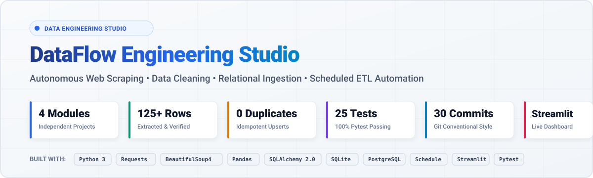
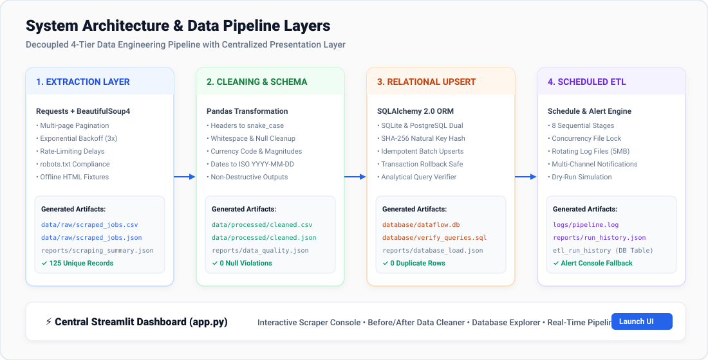
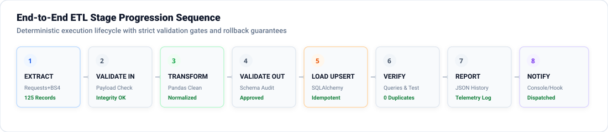
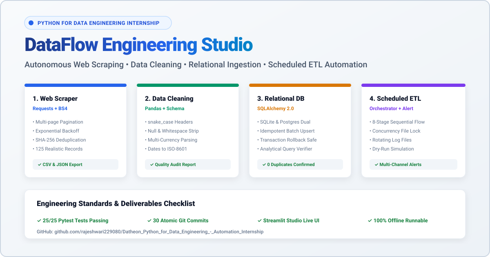

# DataFlow Engineering Studio
## Autonomous Web Scraping, Data Cleaning, Relational Ingestion & Scheduled ETL Automation

<p align="center">
  
</p>

<p align="center">
  <a href="https://www.python.org/downloads/"></a>
  <a href="https://www.sqlalchemy.org/"></a>
  <a href="https://pandas.pydata.org/"></a>
  <a href="https://streamlit.io/"></a>
  <a href="https://pytest.org/"></a>
  <a href="LICENSE"></a>
</p>

An enterprise-grade, execution-ready internship project suite consisting of **FOUR independent Python projects** unified through a modern central web dashboard. Built for data engineering evaluators, students, and practitioners.

---

## 🏛️ System Architecture & Data Pipeline Layers

The architecture employs a clean, decoupled 4-tier pipeline design with a centralized presentation layer:

<p align="center">
  
</p>

---

## ⏱️ End-to-End Pipeline Workflow Sequence

The pipeline implements a strict sequential state machine with mutual exclusion locking and automatic rollback isolation:

<p align="center">
  
</p>

---

## 📦 The Four Independent Projects

<table width="100%">
  <thead>
    <tr>
      <th width="25%">🕷️ Project 1: Scraper</th>
      <th width="25%">🧹 Project 2: Cleaner</th>
      <th width="25%">🗄️ Project 3: Database</th>
      <th width="25%">⏱️ Project 4: Pipeline</th>
    </tr>
  </thead>
  <tbody>
    <tr>
      <td valign="top">
        <strong>Requests + BS4</strong><br/>
        • Multi-page pagination<br/>
        • 3x Exponential backoff<br/>
        • robots.txt parsing<br/>
        • SHA-256 natural key hash<br/>
        • 125 realistic records<br/>
        • Offline HTML fixtures<br/>
        <br/>
        <a href="projects/project_1_scraper/README.md"><strong>Project 1 Docs »</strong></a>
      </td>
      <td valign="top">
        <strong>Pandas + Schema</strong><br/>
        • snake_case headers<br/>
        • Whitespace & null stripping<br/>
        • Currency magnitude parsing<br/>
        • ISO-8601 date normalization<br/>
        • Schema constraint checks<br/>
        • Quality audit reports<br/>
        <br/>
        <a href="projects/project_2_data_cleaning/README.md"><strong>Project 2 Docs »</strong></a>
      </td>
      <td valign="top">
        <strong>SQLAlchemy 2.0</strong><br/>
        • SQLite & Postgres dual-engine<br/>
        • Idempotent batch upserts<br/>
        • Transaction rollback safety<br/>
        • 0 duplicate guarantee<br/>
        • Analytical query suite<br/>
        • Masked credential logs<br/>
        <br/>
        <a href="projects/project_3_database_ingestion/README.md"><strong>Project 3 Docs »</strong></a>
      </td>
      <td valign="top">
        <strong>Schedule + Alerting</strong><br/>
        • 8 Sequential stages<br/>
        • .pipeline.lock file mutex<br/>
        • Rotating log files (5MB)<br/>
        • Multi-channel notifications<br/>
        • Dry-run simulation mode<br/>
        • Relational run history<br/>
        <br/>
        <a href="projects/project_4_scheduled_etl/README.md"><strong>Project 4 Docs »</strong></a>
      </td>
    </tr>
    <tr>
      <td><code>python projects/project_1_scraper/run.py</code></td>
      <td><code>python projects/project_2_data_cleaning/run.py</code></td>
      <td><code>python projects/project_3_database_ingestion/run.py</code></td>
      <td><code>python projects/project_4_scheduled_etl/run.py</code></td>
    </tr>
  </tbody>
</table>

---

## 🚀 Quick Start Guide

### 1. Installation
Clone the repository and install dependencies:
```bash
git clone https://github.com/rajeshwari229080/Datheon_Python_for_Data_Engineering_-_Automation_Internship.git
cd Datheon_Python_for_Data_Engineering_-_Automation_Internship
pip install -r requirements.txt
```

### 2. Launch the Central Streamlit Dashboard
```bash
streamlit run app.py
```
Open your browser at `http://localhost:8501` to access all 4 projects through a graphical interface.

### 3. Run Projects Independently via CLI

```bash
# Project 1: Run Web Scraper (Extracts 125 records from HTML fixtures)
python projects/project_1_scraper/run.py

# Project 2: Run Data Cleaner & Schema Validator
python projects/project_2_data_cleaning/run.py

# Project 3: Run Database Ingestion & Analytical Queries
python projects/project_3_database_ingestion/run.py

# Project 4: Run Manual End-to-End Pipeline
python projects/project_4_scheduled_etl/run.py

# Project 4: Run Pipeline in Dry-Run Mode (Rolls back database writes)
python projects/project_4_scheduled_etl/run.py --dry-run

# Project 4: Run Scheduled Pipeline (Every 30 minutes)
python projects/project_4_scheduled_etl/run.py --schedule --interval 30
```

---

## 🧪 Automated Testing

Run the automated test suite across all 4 projects:
```bash
pytest tests/ -v
```

```text
tests/test_cleaner.py::test_column_normalizer PASSED                     [  4%]
tests/test_cleaner.py::test_column_collision_resolution PASSED           [  8%]
tests/test_cleaner.py::test_string_sanitizer PASSED                      [ 12%]
tests/test_cleaner.py::test_currency_parser_ranges PASSED                [ 16%]
tests/test_cleaner.py::test_currency_parser_k_notation PASSED            [ 20%]
tests/test_cleaner.py::test_date_normalizer PASSED                       [ 24%]
tests/test_cleaner.py::test_schema_validator PASSED                      [ 28%]
tests/test_cleaner.py::test_clean_dataset_end_to_end PASSED              [ 32%]
tests/test_database.py::test_table_creation PASSED                       [ 36%]
tests/test_database.py::test_insert_and_idempotent_upsert PASSED         [ 40%]
tests/test_database.py::test_transaction_rollback PASSED                 [ 44%]
tests/test_database.py::test_analytical_queries PASSED                   [ 48%]
tests/test_database.py::test_dry_run_does_not_modify_db PASSED           [ 52%]
tests/test_pipeline.py::test_concurrency_lock_lifecycle PASSED           [ 56%]
tests/test_pipeline.py::test_pipeline_dry_run_execution PASSED           [ 60%]
tests/test_pipeline.py::test_pipeline_live_e2e_execution PASSED          [ 64%]
tests/test_pipeline.py::test_notification_console_fallback PASSED        [ 68%]
tests/test_scraper.py::test_extractor_parses_job_cards PASSED            [ 72%]
tests/test_scraper.py::test_extractor_finds_next_page PASSED             [ 76%]
tests/test_scraper.py::test_extractor_empty_html PASSED                  [ 80%]
tests/test_scraper.py::test_deduplicator_filters_duplicates PASSED       [ 84%]
tests/test_scraper.py::test_polite_http_client_fixture_reading PASSED    [ 88%]
tests/test_scraper.py::test_polite_http_client_missing_fixture PASSED    [ 92%]
tests/test_scraper.py::test_reporter_metrics_and_summary PASSED          [ 96%]
tests/test_scraper.py::test_full_offline_scraper_execution PASSED        [100%]

============================= 25 passed in 4.57s ==============================
```

---

## 📢 Social & Community Showcase

<p align="center">
  
</p>

- Complete social copy is available in [linkedin.md](linkedin.md).
- Social infographic image is saved as [image.png](image.png) and [assets/linkedin_post.png](assets/linkedin_post.png).

---

## 📂 Project Directory Structure

```
├── app.py                             # Central Streamlit Dashboard
├── requirements.txt                   # Production dependencies
├── LICENSE                            # MIT License
├── .gitignore                         # Git exclusion rules
├── .env.example                       # Environment template (No hardcoded secrets)
├── linkedin.md                        # LinkedIn announcement copy
├── image.png                          # LinkedIn post infographic (Light Theme)
├── assets/                            # Vector & raster visual assets
│   ├── hero_banner.svg                # Top README hero banner
│   ├── architecture_diagram.svg       # 4-tier architecture infographic
│   ├── pipeline_workflow.svg          # 8-stage ETL progression diagram
│   ├── linkedin_post.svg              # LinkedIn vector infographic
│   └── linkedin_post.png              # LinkedIn raster infographic
├── config/
│   ├── scraper_config.json            # CSS selectors, pagination & request rules
│   ├── schema.json                    # Strict dataset schema & constraints
│   └── pipeline_config.json           # Pipeline stages & scheduler parameters
├── data/
│   ├── fixtures/                      # Multi-page HTML fixtures (125 records) & dirty CSV
│   ├── raw/                           # Raw extracted datasets (CSV & JSON)
│   └── processed/                     # Cleaned, validated datasets (CSV & JSON)
├── database/
│   ├── dataflow.db                    # Populated SQLite database
│   └── verify_queries.sql             # ANSI SQL analytical verification queries
├── docs/
│   ├── architecture.md                # System design & Mermaid diagrams
│   ├── data_dictionary.md             # Complete schema column specifications
│   ├── troubleshooting.md             # Operational FAQ & recovery guide
│   └── internship_demo.md             # Evaluator demonstration sequence
├── logs/
│   └── pipeline.log                   # Rotating execution log files
├── reports/
│   ├── scraping_summary.json          # Scraper metrics & page logs
│   ├── data_quality_report.json       # Nullity rates & schema violations
│   ├── database_load_report.json      # Ingestion & table verification metrics
│   └── run_history.json               # Full pipeline execution telemetry
├── src/
│   ├── scraper/                       # Project 1 extraction core
│   ├── cleaner/                       # Project 2 normalization & schema validation
│   ├── database/                      # Project 3 SQLAlchemy models & upsert engine
│   ├── pipeline/                      # Project 4 orchestration & scheduling
│   ├── notifications/                 # Multi-channel alert dispatchers
│   └── reporting/                     # Rotating logger & HTML report builders
├── projects/
│   ├── project_1_scraper/             # Standalone runner & documentation
│   ├── project_2_data_cleaning/       # Standalone runner & documentation
│   ├── project_3_database_ingestion/  # Standalone runner & documentation
│   └── project_4_scheduled_etl/       # Standalone runner & documentation
└── tests/
    ├── conftest.py                    # Shared pytest fixtures
    ├── test_scraper.py                # Project 1 test suite
    ├── test_cleaner.py                # Project 2 test suite
    ├── test_database.py               # Project 3 test suite
    └── test_pipeline.py               # Project 4 test suite
```

---

## 🎓 Internship Evaluation Script
For step-by-step instructions on presenting this project during an internship viva or evaluation, please consult the [Internship Demonstration Guide](docs/internship_demo.md).

---

## 📄 License
This project is licensed under the [MIT License](LICENSE) - see the `LICENSE` file for details.
