# System Architecture & Technical Design Document
## DataFlow Engineering Studio

### 1. Architectural Overview

DataFlow Engineering Studio is an autonomous, modular data engineering suite built on a decoupled Layered Pipeline Architecture. Each phase operates with strict input/output boundaries, allowing independent testing and maintenance while enabling consolidated orchestration.

```mermaid
flowchart TD
    subgraph INGESTION["Layer 1: Web Extraction (Project 1)"]
        HTML[Paginated HTML / Local HTML Fixtures]
        HTTP[PoliteHttpClient: Backoff, Rate Limits, Robots.txt]
        BS4[BeautifulSoup4 Selector Engine]
        DEDUP[SHA-256 Natural Key Fingerprinter]
        RAW_CSV[(data/raw/scraped_jobs.csv)]
        RAW_JSON[(data/raw/scraped_jobs.json)]

        HTML --> HTTP --> BS4 --> DEDUP --> RAW_CSV & RAW_JSON
    end

    subgraph CLEANING["Layer 2: Data Cleaning & Schema Transformation (Project 2)"]
        RAW_CSV --> NORM[ColumnNormalizer: snake_case]
        NORM --> SAN[StringSanitizer: Whitespace & Null Handling]
        SAN --> CURR[CurrencyParser: Preserves Code & Numeric Range]
        CURR --> DATE[DateNormalizer: ISO-8601 Multi-Format]
        DATE --> VAL[SchemaValidator: Type & Constraint Enforcer]
        VAL --> PROC_CSV[(data/processed/cleaned_jobs.csv)]
        VAL --> PROC_JSON[(data/processed/cleaned_jobs.json)]
        VAL --> QUAL_REP[(reports/data_quality_report.json)]
    end

    subgraph PERSISTENCE["Layer 3: Relational Ingestion & Upsert Engine (Project 3)"]
        PROC_CSV --> FACTORY[DatabaseEngineFactory: SQLite / PostgreSQL]
        FACTORY --> UPSERT[DatabaseUpsertEngine: Batch Idempotency]
        UPSERT --> DB[(Relational DB: SQLite dataflow.db)]
        DB --> VERIFY[DatabaseQueryVerifier: Rollback & Analytics]
        VERIFY --> DB_REP[(reports/database_load_report.json)]
    end

    subgraph ORCHESTRATION["Layer 4: Scheduled ETL Pipeline & Alerting (Project 4)"]
        TRIGGER[Manual CLI / Streamlit UI / Cron / In-Process Scheduler]
        LOCK[ConcurrencyLock: .pipeline.lock File Mutex]
        ORCH[EtlOrchestrator: 8-Stage Sequential State Machine]
        NOTIFY[NotificationManager: Console / Webhook / SMTP]
        RUN_HIST[(etl_run_history Table & reports/run_history.json)]

        TRIGGER --> LOCK --> ORCH
        ORCH --> INGESTION
        ORCH --> CLEANING
        ORCH --> PERSISTENCE
        ORCH --> NOTIFY & RUN_HIST
    end

    subgraph INTERACTION["Layer 5: Unified Streamlit Dashboard"]
        UI[Streamlit Studio: app.py]
        UI --> ORCHESTRATION
        UI --> INGESTION
        UI --> CLEANING
        UI --> PERSISTENCE
    end
```

---

### 2. Design Patterns & Architectural Decisions

#### A. Idempotency & Natural Key Fingerprinting
- **Problem**: Repetitive ETL execution against changing web portals can introduce massive duplication or dirty state.
- **Solution**: A deterministic SHA-256 fingerprint (`record_hash`) is computed from normalized natural keys: `lower(title) | lower(organization) | lower(location)`.
- **Database Behavior**:
  - If `record_hash` is novel $\rightarrow$ `INSERT`.
  - If `record_hash` already exists $\rightarrow$ `UPDATE` non-key columns in-place if changes are detected, otherwise increment `unchanged` counter.
  - Guarantees: Re-running ingestion 100 times results in zero duplicate rows.

#### B. Currency Preservation Without Speculative Conversion
- **Problem**: Multi-currency scraping presents salary values in USD, EUR, GBP, and INR.
- **Solution**: The currency symbol is extracted into an ISO-standard code (`USD`, `EUR`, `GBP`, `INR`), and compensation is parsed into `salary_min` and `salary_max` numeric values. Foreign exchange conversions are deliberately avoided to maintain financial accuracy without time-dependent FX assumptions.

#### C. Concurrency Control & Safe Lock Management
- **Problem**: Cron jobs or UI clicks could accidentally trigger concurrent pipeline instances, creating race conditions.
- **Solution**: A filesystem token lock (`.pipeline.lock`) holds the current process PID and timestamp. If a second instance attempts to run while the lock is held, it terminates immediately with an explanatory error. Stale locks (> 30 minutes) are automatically cleared to recover from server crashes.

#### D. Dialect-Agnostic SQLAlchemy 2.0 Layer
- Runs locally by default using zero-dependency SQLite (`database/dataflow.db`).
- Seamlessly transitions to enterprise PostgreSQL in staging/production by configuring the `DATABASE_URL` environment variable.
